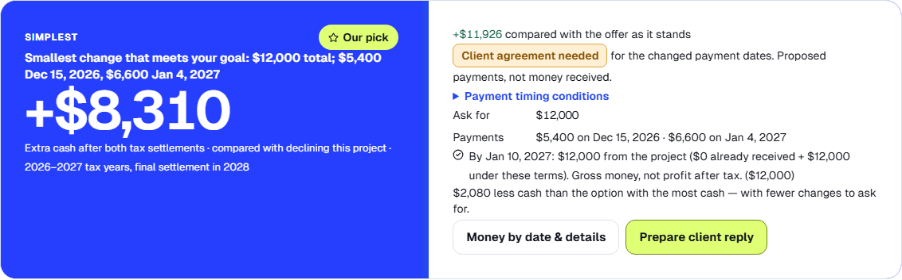
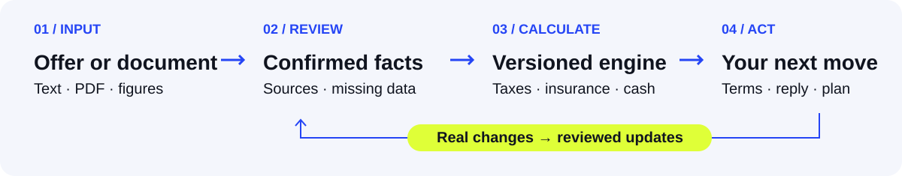

<p align="center">
  <a href="https://headroom-amber.vercel.app"></a>
</p>

<p align="center">
  <strong><a href="https://headroom-amber.vercel.app">Open Headroom ↗</a> &nbsp; · &nbsp; <a href="https://raw.githubusercontent.com/Mustiks07/headroom/main/docs/presentation/headroom-business-cup.pdf">Download 10-slide pitch</a> &nbsp; · &nbsp; <a href="docs/demo/round6-judge-script.md">Live walkthrough</a> &nbsp; · &nbsp; <a href="docs/presentation/README.md">Evidence & business model</a></strong>
</p>

**Understand a client offer before you agree.** Headroom shows independent professionals what remains for their household after project costs, taxes and Marketplace health insurance. Set your cash needs and payment limits, compare workable terms, prepare a client reply, and keep the decision current as the deal changes.

**Open immediately. No signup, email, password or payment gate.** Built for US adults aged 25–45 who work for themselves and buy Marketplace coverage. English, browser-only, B2C.

## Same fee. Better terms.

An illustrative Tennessee family receives a **$12,000 offer**. The payment schedule changes its household outcome:

| The client pays | Extra household cash after tax settlements |
|---|---:|
| $12,000 on December 20, 2026 | **−$3,616** |
| $5,400 on December 15, 2026 + $6,600 on January 4, 2027 | **+$8,310** |

**$11,926 better than the original terms. Same project fee. No additional retirement contribution.**

<a href="docs/artifacts/round6/ui/case1-terms-desktop.png"></a>

*Actual application output for a documented illustrative household. Both outcomes are compared with declining the unpaid project, after the relevant tax settlements. County benchmark assumptions apply; the client must agree and payment timing must be eligible. These are calculated case results, not customer savings.* [Inspect the inputs and independent check →](docs/artifacts/round6/scenarios/decision-cases.md)

**Reproduce it:** download [the case 1 plan](https://raw.githubusercontent.com/Mustiks07/headroom/main/docs/artifacts/round6/ui/case-1-importable.json), open [Your plans](https://headroom-amber.vercel.app/household), choose **Restore from a file**, then **Find workable terms → Find terms**. The app recalculates from inputs. Or [start with your own offer](https://headroom-amber.vercel.app/check?start=project).

## A complete decision, from offer to payment

| When something happens | What Headroom does |
|---|---|
| **A new offer arrives** | Reads text or a document, asks for missing facts, and shows the offer as written before suggesting changes. |
| **You need different terms** | Searches allowed prices and payment dates against cash needs and retirement limits, with existing agreements included. |
| **The client counters** | Previews the household effect, records the revised terms after confirmation, and preserves the original offer. |
| **Only part of a payment arrives** | Records the actual receipt and keeps the dated remainder separate. |
| **Income or documents change** | Reviews the affected facts, recalculates the plan, and updates the next actions. |
| **You are ready to act** | Produces an editable client reply, a decision PDF, restorable plan data and calendar actions. |

No client message is sent automatically. A proposed term, an agreement and money actually received remain distinct throughout the product.

## The difference is the workflow

Free ACA calculators and broad financial planners already serve useful jobs. Headroom focuses on **one real client decision and its consequences**: the offer, household facts, feasible terms, reply, agreement and payment changes stay connected.

- **Constraints come from the person.** How much cash is needed, by when, what dates the client can accept and how much can go into retirement.
- **The result has a usable next step.** A proposal to discuss, an editable message and dated actions, rather than a warning alone.
- **The next visit starts from the existing plan.** A counteroffer or partial receipt updates the same decision and retains its history.

[Read the scenario-based competitor research →](docs/research/round6-competition-pitch.md)

## AI reads. Code calculates.



**Next.js + TypeScript** power the browser and APIs on Vercel. A **deterministic, versioned engine** calculates tax, premium credits and household cash with decimal arithmetic and documented rounding. Optional **AI** reads messages and documents; users review proposed facts. **Supabase** provides private anonymous guest persistence without an account screen.

- Unknown facts remain unknown. A missing spouse income or unsupported situation blocks the affected answer.
- Source, year and person travel with imported figures. Conflicting document changes are reviewed together before they are applied.
- Text PDFs work without AI. Scanned PDFs and photos use pasted or manual figures.
- Cash, retirement principal and credit settlement are shown separately. Historical decisions retain their original inputs; stale results cannot become a current export.

[Architecture](docs/ARCHITECTURE.md) · [Financial engine](docs/ENGINE_SPEC.md) · [Source registry](docs/SOURCES.md) · [Privacy](https://headroom-amber.vercel.app/privacy)

## Built, integrated and exercised

The combined release was checked through real browser journeys: family, ordinary profitable offer, missing facts, document review, client counteroffer, partial payment, save/reopen and downloaded PDF/calendar outputs. The core journey was also repeated on the public deployment. Mobile was inspected at 360px.

Production build and TypeScript checks passed. Supabase passed **28 isolation checks**, including cross-guest access and server-only AI counters. Live provider smoke checks exercised an offer email and a text W-2 PDF. These are bounded engineering checks, not a claim of general AI accuracy or professional tax certification.

[Release record](docs/handoffs/integration-round6.md) · [Actual screenshots and exports](docs/artifacts/round6/ui/) · [Technical proof](docs/demo/round6-technical-proof.md)

## A business built around the decision

Our proposed launch package is **$29 for one offer decision, including 30 days of revisions**. Ongoing project work is the basis for a **$99 annual plan**, to validate after repeat demand. The current app is free to use.

The research connects official Marketplace data, paid-category alternatives, competitor workflows, acquisition channels and a reproducible financial model. The first channel tests focus on broker referrals and independent-worker communities. The household pays: this remains B2C.

[Market and launch decisions](docs/research/round6-launch-decisions.md) · [Pricing research](docs/research/round6-monetization-review.md) · [Unit economics and sensitivities](docs/research/round6-economics.md) · [97 participant repositories reviewed](docs/research/COMPETITOR_REPOS_ROUND5.md)

## Run it yourself

Use Node 22.

```sh
npm ci
npm run dev
```

Open `http://localhost:3000`. Calculations and browser-local storage work without credentials. For optional cloud save and AI, copy `.env.example` to `.env.local` and follow [deployment configuration](docs/DEPLOYMENT.md). Never commit credentials.

```sh
npm run typecheck
npm test
npm run build
```

For the current browser walkthrough use [the round 6 script](docs/demo/round6-judge-script.md). The legacy `check:ui` script targets older screens.

<details>
<summary><strong>Supported calculations and review boundaries</strong></summary>

The current scope is federal planning for Texas, Florida and Tennessee; single or married filing jointly; one sole-proprietor business; supported W-2 wages and interest; full-year Marketplace eligibility in 2026–2027; and an owner-only SEP-IRA. It is a planning tool, not tax filing or an official Marketplace eligibility decision.

The search evaluates permitted candidates and rechecks displayed options with the full engine. It does not claim a global optimum between search points. Calendar files are downloadable snapshots, not a live subscription. Some illustrative insurance inputs use CMS county plan candidates with address availability and eligibility assumed.

Current versions: `headroom-engine-1.3.0`, `headroom-household-1.0.1`, `headroom-deal-1.2.0`, `us-federal-aca-2026-2027.r3`.

[Engine scope](docs/ENGINE_SPEC.md) · [Finite acceptance checks](docs/ACCEPTANCE.md) · [Integrated handoff](docs/handoffs/integration-round6.md)

</details>

<details>
<summary><strong>Specification, collaboration and research archive</strong></summary>

[Product specification](docs/TZ.md) · [Design system C](docs/design/c-open/README.md) · [Round 6 shared brief](docs/tasks/ROUND6_SHARED.md) · [Claude 1 delivery](docs/handoffs/claude1-round6.md) · [Claude 2 delivery](docs/handoffs/claude2-round6.md) · [Claude 3 delivery](docs/handoffs/claude3-round6.md) · [Research index](docs/research/README.md)

Contributors start with [AGENTS.md](AGENTS.md) and [CLAUDE.md](CLAUDE.md), using separate branches/worktrees and the shared domain contracts. Public-facing figures must match the current engine and documented source.

</details>

---

**Business Cup · Money · B2C · Web**

**[Try Headroom ↗](https://headroom-amber.vercel.app) · [Download the pitch](https://raw.githubusercontent.com/Mustiks07/headroom/main/docs/presentation/headroom-business-cup.pdf) · [Submission materials](docs/presentation/README.md)**
