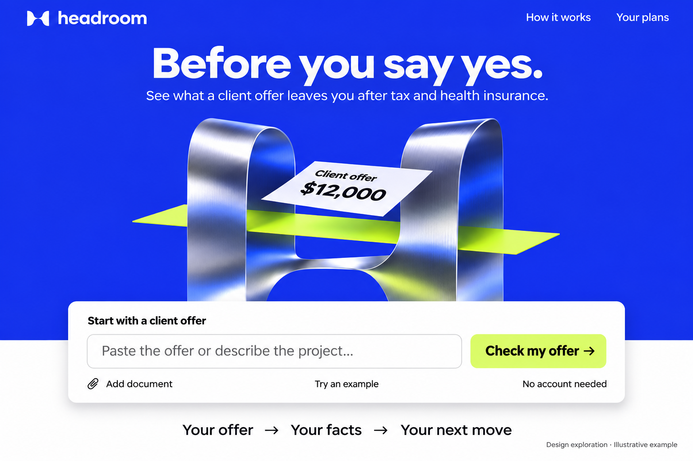
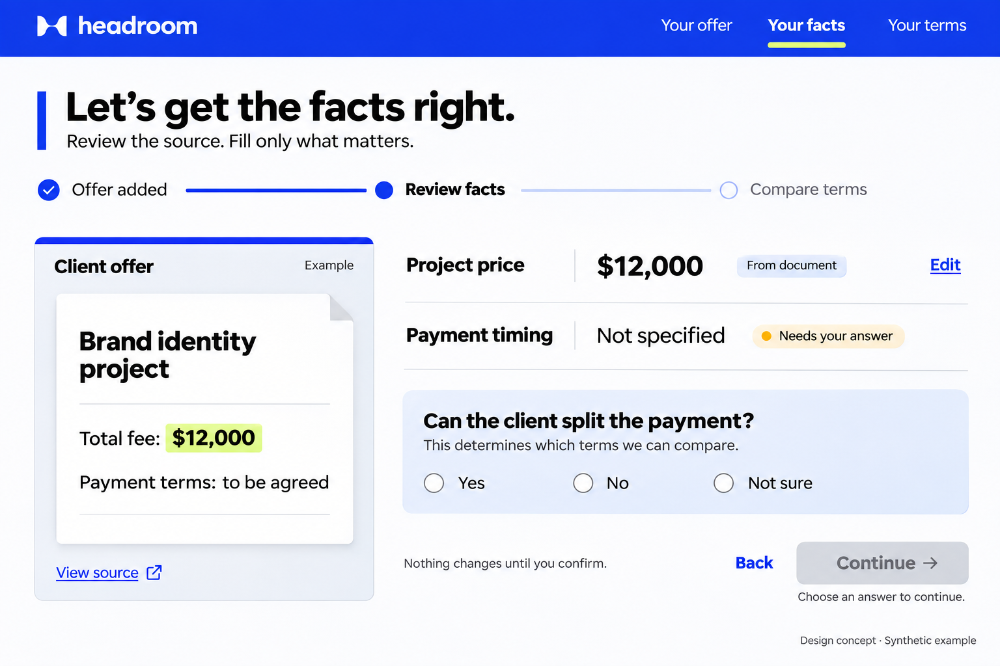
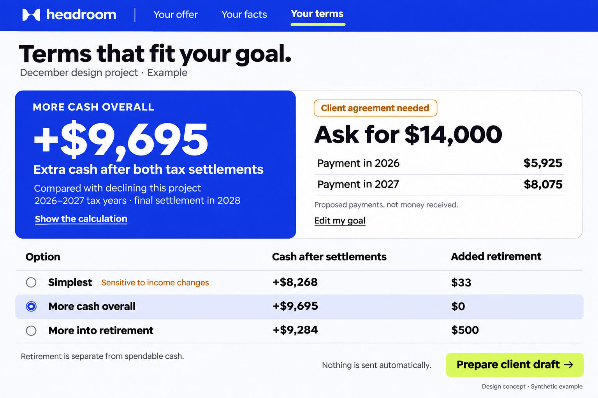

# Headroom C — selected design

**Selected by the user on November 15, 2026. Implementation references, not a released interface.** This replaces the rejected green/beige/serif round5 proposal. Preserve the selected composition and all existing functional requirements.

## What to build

A bold cobalt landing page, a chrome H with a chartreuse plane, a short headline and a white live offer-entry tray. The working screens use light surfaces, cobalt navigation/results, clear numerical hierarchy and chartreuse primary actions. Use English throughout and keep the full guest journey available without registration.

- [Visual specification](spec.md): composition, Geist Sans, sizes, layout, responsive behavior, states and motion.
- [Implementation tokens](tokens.json): explicit colors, spacing, type and calculated contrast.
- [Claude 1 handoff](claude1-handoff.md): actual code areas, full journey, financial semantics and one bounded acceptance pass.
- [Native SVG mark](headroom-mark.svg), [small-size proof](logo-proof.png).
- [Transparent chrome scene](05-hero-scene.png), [rendered over cobalt](hero-on-cobalt-proof.png). Decorative material only; paper, text, fields and controls stay live HTML/SVG.

## Screen references

| Screen | Purpose |
| --- | --- |
| [Selected home](01-home-selected.png) | Unchanged chosen C; SHA-256 matches its original. |
| [Review facts](02-review-desktop.png) | Source context, pending facts and an unanswered clarifying question. |
| [Desktop result](03-result-desktop.png) | One clear outcome, conditional terms and comparison. |
| [Mobile result](04-result-mobile.png) | Same financial meaning in a readable stacked layout. |

The PNGs are visual references. They do not replace working components, exact font measurement, responsive verification or live calculations. The mobile horizon selector is also required on desktop even though the desktop concept omits it. Unshown states and the complete draft/agreement/payment/update journey remain required in the handoff.

The synthetic +$9,695 illustrates incremental project cash versus declining after both 2026 and 2027 tax settlements, including final settlement in 2028. It is not savings created by Headroom, today's bank balance or a real customer outcome. Bind the live UI to engine output under matching facts, baseline and horizon. The image selection is not a hardcoded recommendation. Changed price and payment terms require client agreement; expected money is not received money.

## Reference study and provenance

The direction was chosen after reviewing public page renders from [Stripe](https://stripe.com/), [Apple MacBook Pro](https://www.apple.com/macbook-pro/) and [Mercury](https://mercury.com/), plus [Linear's design-refresh explanation](https://linear.app/now/behind-the-latest-design-refresh). Linear's public page render did not load its hero correctly, so no full-page visual assessment is claimed for that capture. Observed principles informed hierarchy and composition; no company's logo, proprietary font or imagery is included here. The colors come from the user's selected C, not a requirement to preserve Headroom's old palette.

[Geist's official repository](https://github.com/vercel/geist-font) supplies font and OFL license provenance; keep the license when serving a font build. The mark is native authored SVG. The concept screens and isolated scene were generated as derivatives of the selected reference using image generation; [saved prompts](generation-prompts.json) describe those four generations. [Asset metadata](assets.json) records image dimensions/hashes and the scene's alpha channel. The full-screen concepts have opaque backgrounds; the scene has transparency.

Before publishing implemented UI, inspect the actual final build and exported artifacts under the handoff acceptance pass. Do not substitute concept PNGs for implementation evidence or replace user-provided final materials.
